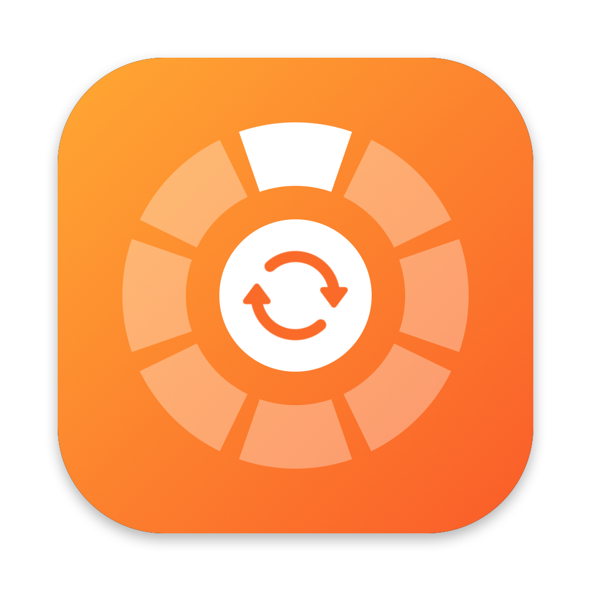

<p align="center"></p>

<h1 align="center">Flipdial</h1>

<p align="center">Convert, edit and share files on your Mac without letting go of the mouse.</p>

Start dragging any file, then press a key while you hold it:

| Key | Wheel | What it does |
|-----|-------|--------------|
| **⇧ Shift** | Convert | Images, video, audio, documents, PDF, slides, spreadsheets, subtitles, archives |
| **⌘ Command** | Tools | Crop, compress, resize, rotate, trim, merge, split, password-protect, remove backgrounds… |
| **⌃ Control** | Actions | AirDrop, Float on top, Copy, Move To, Copy Path, Terminal, Reveal, Duplicate |

Pick with **← →** and press **Return**, or drop the file onto a slice. **Tab** switches wheels and **Esc** cancels.
Results are saved next to the original. Everything runs locally on your Mac.

## Install

1. Download `Flipdial-<version>.zip` from [Releases](../../releases) and unzip it.
2. Move **Flipdial.app** to your **Applications** folder.
3. Open it. macOS will say it can't verify the developer, because the app isn't notarized by Apple.
   Go to **System Settings → Privacy & Security**, scroll down and click **Open Anyway**.
4. When asked, allow **Accessibility** access (System Settings → Privacy & Security → Accessibility).
   Flipdial needs it to notice ⇧ ⌘ ⌃ while you drag. After updating to a new version, switch it off and on again.

Flipdial lives in the menu bar. Requires macOS 14 or later on Apple silicon.

## Formats

| Kind | Converts to |
|------|-------------|
| Images (JPG, PNG, HEIC, WebP, AVIF, TIFF, GIF, BMP, SVG…) | JPG, PNG, HEIC, WebP, AVIF, TIFF, GIF, BMP, ICNS, PDF, DOCX, Text (OCR) |
| Video (MP4, MOV, MKV, WebM, AVI, WMV…) | MP4, MOV, MKV, WebM, AVI, WMV, GIF, MP3, M4A, WAV |
| Audio (MP3, M4A, WAV, FLAC, OGG, Opus, AIFF, WMA, AAC) | all of those |
| Documents (DOCX, DOC, ODT, RTF, HTML, TXT, Markdown, EPUB) | DOCX, PDF, Text, Markdown, RTF, HTML, ODT, EPUB, PNG, JPG |
| PDF | DOCX, PPTX, XLSX, CSV, JPG, PNG, EPUB, Text, Markdown, RTF, HTML |
| Spreadsheets (XLSX, ODS, CSV, TSV, XLS) | XLSX, CSV, TSV, ODS, PDF, HTML, JSON, Markdown — every sheet |
| Slides (PPTX, PPT, ODP) | PDF, JPG, PNG, PPTX, ODP, Text, Markdown |
| Subtitles (SRT, VTT) | SRT, VTT, Text |
| Archives (ZIP, TAR, GZ, RAR, 7z) | Extract, ZIP, TAR, TAR.GZ |

Everything works out of the box: FFmpeg ships inside the app. Two free extras are used automatically if installed:

- [LibreOffice](https://www.libreoffice.org/download/download/): needed for PowerPoint slides and old `.xls` files.
- [Pandoc](https://pandoc.org/installing.html): optional, gives higher-fidelity Markdown and EPUB conversions.

## Build from source

Requires Xcode 15+ and Homebrew's `ffmpeg` and `webp` (bundled into the app at build time):

```sh
brew install ffmpeg webp
./build.sh --install      # build and copy to ~/Applications
./build.sh --release      # build dist/Flipdial-<version>.zip
```

There's also a command line for scripting and testing:

```sh
Flipdial.app/Contents/MacOS/Flipdial list photo.heic             # operations available for a file
Flipdial.app/Contents/MacOS/Flipdial run convert.png photo.heic  # run one
Flipdial.app/Contents/MacOS/Flipdial engines                     # which helper programs were found
```

## License

Flipdial is MIT-licensed. Release builds include FFmpeg (GPL v3) as a separate program; see
[THIRD_PARTY_NOTICES.md](THIRD_PARTY_NOTICES.md).
